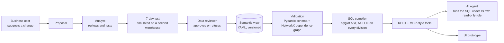
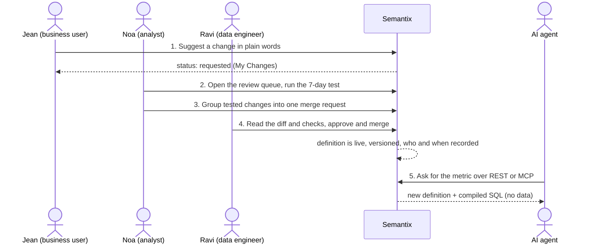

# Governed Metrics Gateway (Semantix)

A governed gateway that gives every person and every AI agent the **same definition of every business metric**. Metrics, filters and rules live in one versioned semantic view (YAML in Git). The gateway validates them, compiles them to SQL, and serves them to people and agents over REST and an MCP-style tool interface.


> **Status: local MVP backend and a UI prototype.** The backend (validation, dependency graph, SQL compilation, proposals, simulated test, REST and MCP-style endpoints) is built and has 15 passing tests. The React UI is a prototype with mock data and is not wired to the backend. Warehouse and Git connections, the real MCP protocol and single sign-on are proposed, not built. See [Status](#status).

## The problem

- "Revenue", "return rate" and "active customer" are defined differently in dashboards, SQL and spreadsheets.
- AI agents guess joins and metric logic, so they answer confidently and wrongly.
- Every definition change is an engineering ticket, so data engineers become the bottleneck.

## How it works



1. A YAML semantic view is validated with Pydantic, checked for cycles and broken dependencies with NetworkX, and compiled to SQL through the sqlglot AST. Every division gets a `NULLIF` guard.
2. A change goes through proposal, analyst review, a (simulated) 7-day test, approval and live. An approval that would break lineage is refused, and a metric with downstream dependants cannot be deleted.
3. Agents call tools such as `get_metric_<name>` and receive the definition and the SQL. The gateway sends definitions and SQL only. **The agent runs the SQL itself, under its own read-only role.**

## Who does what

Four kinds of users work together. The names are demo characters, and their pain points are illustrative, not from interviews (see [docs/02-personas.md](docs/02-personas.md)).

| Who | Role | What they do in Semantix | What they never have to do |
|---|---|---|---|
| **Jean** | Business user | Reads a metric, spots a wrong or missing definition, and **suggests a change in plain words**. Follows the request in "My Changes". | write SQL, or file an engineering ticket |
| **Noa** | Data analyst | Owns the meaning of the data. Reviews the queue, edits descriptions and context, runs the **7-day test**, and batches tested changes into **one merge request**. Context-only changes skip engineering. | answer many small requests one by one |
| **Ravi** | Data engineer | Controls what goes live. Reads the diff and the checks on the merge request, **approves or refuses**, rolls back if needed, and manages which agents can reach which views. | be the bottleneck for every wording change |
| **The AI agent** | Non-human consumer | Connects with one address and one key, calls tools such as `get_metric_<name>`, and receives **the definition and the SQL, nothing else**. It runs the SQL itself under its own read-only role. | guess joins or metric logic, or see restricted fields |

### One change, end to end

Scenario: the "net revenue" filter should exclude returned orders.



**Two tiers of change:** analyst-only changes (context and descriptions) go live once Noa approves. Engineering changes (metrics, filters, rules, verified queries, new views) need Ravi's approval on a merge request. Every step records who did it and when.

### What the backend implements today

The documents and the React prototype describe the full flow above. The **backend is a simpler first version** with three demo logins, so the roles map like this:

| Backend demo login | Role in code | Workspace scope | Can review |
|---|---|---|---|
| Jean, E-com Lead | `ecommerce_analyst` | `ecommerce` metrics | no |
| Amélie, Finance Director | `finance_director` | `ecommerce` and `finance` metrics | no |
| Marc, Data Platform Reviewer | `data_reviewer` | `ecommerce` and `finance` metrics | **yes** |

What the backend enforces:

- **Scope:** a user only sees, and can only change, metrics in their own domains (`403` otherwise).
- **Proposals:** anyone in scope can submit a create, update or delete. The draft is validated and compiled first. A metric can have only one change pending review at a time (`409`).
- **Review:** only the reviewer can approve or reject (`403` otherwise). An approval that would break the dependency graph is refused, and a metric with downstream dependants cannot be deleted. Each proposal records `submitted_by`, `reviewed_by` and the review note, with timestamps for each stage (draft, compilation passed, pending review, live or rejected).
- **Agents:** the MCP-style endpoints return a metric's definition and compiled SQL. They never execute it.

The **analyst tier** (Noa), the **7-day test as a batch step**, the **merge request** and the **agent connection management** are shown in the React prototype with mock data and are not in the backend yet. The names also differ between the documents (Jean, Noa, Ravi) and the backend demo logins (Jean, Amélie, Marc).

## What is in the repository

| Path | What it is |
|---|---|
| `app/core/` | validator and SQL compiler, dependency graph, proposals, simulator, signed-cookie demo auth |
| `app/interface/` | REST API (`/metrics`, `/metrics/{name}/sql`, `/metrics/{name}/impact`, `/drafts/validate`, `/drafts/simulate`, `/proposals`, `/warehouse`, login and session) and MCP-style tools (`/mcp/tools`, `/mcp/tools/call`) |
| `app/schemas/` | the metric and semantic-layer models |
| `test_metrics.yaml` | the example semantic view (revenue, return rate, operating margin) used by the backend and the tests |
| `web/` | React UI prototype for three roles plus an MCP console (mock data) |
| `tests/` | 15 tests: SQL compilation, graph checks, cost guard, end-to-end HTTP, sessions, scoped access, lifecycle |
| `strip_sample_values.py` | a helper that removes every `sample_values:` block from a warehouse semantic-view YAML export before it is shared |
| `docs/` | overview, personas, user-story map, hybrid-security brief, demo guide, style guide, MVP specification, UI/UX design |

## Quickstart

```bash
pip install -r requirements.txt
uvicorn app.main:app --reload --port 8765      # backend, API on http://127.0.0.1:8765
pytest -q                                      # 15 tests

cd web && npm install && npm run dev           # UI prototype on http://localhost:5173 (proxies /api to :8765)
```

Environment variables: `SEMANTIX_CONFIG` (path to the baseline metrics YAML), `SEMANTIX_SUBMISSIONS` (folder for proposal files) and `SEMANTIX_SECRET` (cookie signing key; a random one is created at start if unset, so sessions reset on restart).

## Status

| Part | State |
|---|---|
| FastAPI backend: validation, dependency graph, SQL compilation, proposals, simulated test, REST and MCP-style endpoints | **Built**, 15 tests passing |
| React UI for three roles plus an MCP console | **Prototype**: mock data, not wired to the backend |
| Warehouse and Git connections, the real MCP protocol, single sign-on (OIDC), hybrid deployment inside a customer network | **Proposed** (see `docs/06-hybrid-security-brief.md`) |
| Market size, competitors, pricing, traction | **Unverified**: none sourced, none claimed |

Limits to know about:

- Login is a demo identity picker with a signed cookie and no passwords. Replace it with SSO before any shared deployment.
- The "7-day test" runs against a seeded in-memory SQLite copy, not a real warehouse.
- There is no warehouse driver, so nothing here has been run against a real warehouse or Git host.
- Items about security, cost or people in the docs should be reviewed by a human before they are relied on.

## License

[MIT](LICENSE)
